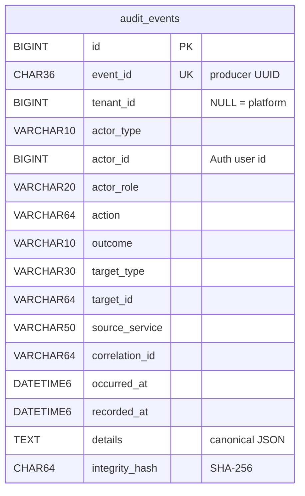

# Audit Log Service: API and Database Contract

Subtask 01 · Version 1.0 · Base path `/api/audit` (gateway `http://localhost:8080`, direct `http://localhost:8091`) · JSON, UTF-8, ISO-8601 UTC timestamps.

## 1. The audit event

An audit event is an **append-only** fact: who (actor) did what (action), with what result (outcome), to what (target), when (timestamp), and within which business transaction (correlation ID).

### Identifiers

| Field | Owner | Meaning | Constraint |
|---|---|---|---|
| `id` | this service | row id | int64, generated |
| `eventId` | **producer** | idempotency key of the event | UUID, unique (409 on repeat) |
| `tenantId` | Organizer/Tenant Service | tenant the action belongs to; null = platform-level | positive int64; must exist in the Tenant Service when the check is on (422) |
| `actorId` | Auth Service (`sub`) | user who acted | positive int64; **required when `actorType = USER`** |
| `targetType` + `targetId` | the service owning the target | entity acted upon (e.g. `ORDER` `5001`) | enum + `^[A-Za-z0-9._:-]{1,64}$` |
| `sourceService` | platform | service that reports the event | `^[a-z][a-z0-9-]{2,49}$` **and** in the known-service list (422) |
| `correlationId` | the request chain | ties together all events of one business transaction | `^[A-Za-z0-9._-]{8,64}$`; body → `X-Correlation-Id` header → new UUID |

### Fields and constraints

| Field | Type | Required | Rule |
|---|---|---|---|
| eventId | UUID | yes | unique |
| tenantId | int64 | no | > 0; required when `actorRole = ORGANIZER` |
| actorType | `USER` \| `SERVICE` \| `SYSTEM` | yes | |
| actorId | int64 | if USER | > 0 |
| actorRole | `STUDENT` \| `ORGANIZER` \| `ADMIN` \| `SERVICE` | no | only for USER actors (or `SERVICE`) |
| action | string | yes | `UPPER_SNAKE_CASE`, 3–64, e.g. `PAYMENT_VERIFIED` |
| outcome | `SUCCESS` \| `FAILURE` \| `DENIED` | yes | |
| targetType | `USER, TENANT, EVENT, TICKET, PRIZE, ORDER, PAYMENT, PAYMENT_PROOF, DRAW, WINNER, NOTIFICATION, RISK_CHECK, RISK_FLAG, RISK_RULE, REPORT, SYSTEM` | yes | |
| targetId | string | yes | 1–64 `[A-Za-z0-9._:-]` |
| sourceService | string | yes | known service name |
| correlationId | string | no | see above |
| occurredAt | instant | yes | not more than 5 minutes in the future |
| details | JSON object | no | ≤ 50 keys, ≤ 4000 characters (stored as canonical JSON, keys sorted) |
| recordedAt | instant | response only | server clock, microsecond precision |
| integrityHash | hex | response only | SHA-256 of all fields above |
| integrityValid | boolean | response only | stored data still matches `integrityHash` |

**Known `sourceService` values:** `api-gateway`, `auth-service`, `user-profile-service`, `tenant-service`, `event-service`, `ticket-inventory-service`, `prize-catalog-service`, `order-service`, `payment-qr-service`, `payment-proof-service`, `payment-verification-service`, `bulk-verification-service`, `draw-service`, `winner-service`, `fairness-verification-service`, `notification-service`, `email-template-service`, `audit-log-service`, `analytics-service`, `scheduler-service`, `fraud-risk-service`.

You can change the list with `app.audit.known-sources`.

## 2. Endpoints

| Method & path | Roles | Success | Errors |
|---|---|---|---|
| `POST /events` | SERVICE, ADMIN | **201** + `Location` + `X-Correlation-Id` | 400, 401, 403, 409 duplicate `eventId`, 415, 422 unknown reference, 503 |
| `GET /events` | ADMIN (all), ORGANIZER (own tenant), STUDENT (own actions) | 200 page `{content, page, size, totalElements, totalPages}` | 400, 401, 403 |
| `GET /events/{id}` | same | 200 | 400, 401, 403, 404 |
| `GET /correlations/{correlationId}` | same | 200 list, oldest first, ≤ 500 | 400, 401, 403, 404 (none visible) |
| `PUT` / `PATCH` / `DELETE` | – | – | **405** append-only |
| `GET /actuator/health` | public | 200 | 503 when DB or broker is down |

**Search parameters** (all optional, combined with AND): `tenantId`, `actorId`, `actorType`, `action`, `outcome`, `targetType`, `targetId`, `correlationId`, `sourceService`, `from` (inclusive), `to` (exclusive), `page` ≥ 0, `size` 1–100.

* `from` must be before `to`, and the range can be at most 366 days.
* Results are sorted by `occurredAt` desc, then `id` desc.

**Error body:** `{timestamp, status, error, message, path, fieldErrors?: [{field, message}]}`.

## 3. Database schema (`yongdrel_audit`, Flyway V1)

**Indexes:**

* `(tenant_id, occurred_at)`: organizer scope
* `(actor_id, occurred_at)`: student scope
* `(correlation_id, occurred_at)`: timeline
* `(target_type, target_id)`
* `(action, occurred_at)`

There are no foreign keys to other services' databases (database per service); references are checked over REST and against the service registry.

## 4. Messages consumed (RabbitMQ)

| Exchange | Routing key | Queue | Body |
|---|---|---|---|
| `yongdrel.audit.events` (topic) | `audit.#` | `audit.events` | same JSON as `POST /events` |
| `yongdrel.fraud.events` (topic) | `fraud.flag.#` | `audit.fraud-events` | `{eventType, flagId, checkId, tenantId, eventId, orderId, buyerId, score, riskLevel, reasons, status, reviewerId, occurredAt}` |

* Rejected messages go to `yongdrel.audit.dlx` → `audit.events.dlq`.
* **Fraud flag mapping:**
  * `action` = `FRAUD_FLAG_RAISED` or `FRAUD_FLAG_REVIEWED`.
  * `actorType` = `USER` (the reviewer) when `reviewerId` is set, otherwise `SYSTEM`.
  * The target is `RISK_FLAG`/`flagId`, and the correlation ID is `fraud-flag-{flagId}`.
  * `eventId` is a name-based UUID of `(eventType, flagId, status)`, so redeliveries are idempotent.
