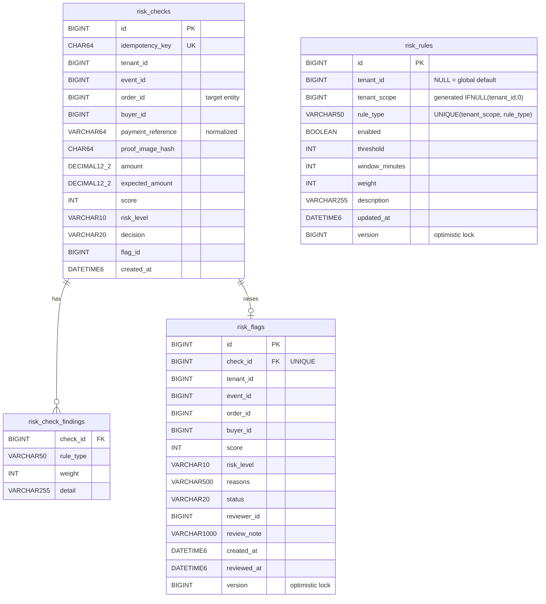

# Fraud & Risk Service: API and Database Contract

Subtask 01 · Version 1.0 · Base path `/api/fraud` (gateway `http://localhost:8080`, direct `http://localhost:8090`) · JSON only (`application/json`), UTF-8, timestamps ISO-8601 UTC.

## 1. Identifiers

### Cross-service identifiers (owned by other services, stored here by value)

| Field | Owner service | Meaning | Constraint | Verified how |
|---|---|---|---|---|
| `tenantId` | Organizer/Tenant Service | organizer that runs the event | positive int64 | must equal the JWT `tenantId` claim for organizers |
| `eventId` | Event Service | lottery event | positive int64 | compared with the order when the order check is on |
| `orderId` | Order Service | **target entity** of a check and flag (one ticket order) | positive int64 | `GET /api/orders/{orderId}` must exist and match tenant, event and buyer (422 otherwise) |
| `buyerId` | Auth Service (`sub`) | student who paid | positive int64 | must equal JWT `sub` for students; compared with the order |
| `reviewerId` | Auth Service (`sub`) | organizer/admin who reviewed | set from JWT `sub`, never from the body | – |
| `paymentReference` | the bank/UPI app (outside the system) | transaction reference typed by the student | 4–64 chars `[A-Za-z0-9 -]`, stored upper-case without spaces/hyphens | duplicate check |
| `proofImageHash` | Payment Proof Service | SHA-256 of the uploaded screenshot | 64 hex chars, stored lower-case | duplicate check |

Every flag targets exactly one **order** (`orderId`). Other services link back with `GET /api/fraud/flags?orderId={id}`.

### Identifiers owned by this service

| Id | Resource | Generated |
|---|---|---|
| `checkId` (`id` on a check) | risk check: one assessed submission | MySQL `AUTO_INCREMENT` |
| `flagId` (`id` on a flag) | risk flag waiting for, or after, manual review; 1:1 with a check | MySQL `AUTO_INCREMENT` |
| `ruleId` (`id` on a rule) | configurable rule | MySQL `AUTO_INCREMENT`; ids 1–5 are the seeded platform defaults |

## 2. Enumerations

| Enum | Values |
|---|---|
| `RuleType` | `DUPLICATE_PAYMENT_REFERENCE`, `DUPLICATE_PROOF_IMAGE`, `BUYER_VELOCITY`, `AMOUNT_MISMATCH`, `PRIOR_CONFIRMED_FRAUD` |
| `RiskLevel` (score) | `NONE` (0), `LOW` (1–29), `MEDIUM` (30–69), `HIGH` (70–100) |
| `Decision` | `CLEAR`, `REVIEW_REQUIRED` (score ≥ flag threshold 30 → a flag is created) |
| `FlagStatus` (review state) | `OPEN`, `UNDER_REVIEW`, `CONFIRMED_FRAUD`, `DISMISSED` |
| `scope` (rule) | `GLOBAL` (tenantId null), `TENANT` |

**Review state transitions** (anything else is 409):

```
OPEN ──► UNDER_REVIEW ──► CONFIRMED_FRAUD
  │            └────────► DISMISSED
  ├──────────────────────► CONFIRMED_FRAUD
  └──────────────────────► DISMISSED          (closed states are final; closing requires a note)
```

**Score:** the sum of the weights of the rules that fired, capped at 100.

## 3. Resources

### RiskCheckRequest (`POST /checks`)

| Field | Type | Required | Constraint |
|---|---|---|---|
| tenantId, eventId, orderId, buyerId | int64 | yes | > 0 |
| paymentReference | string | one of these two | `^[A-Za-z0-9 -]{4,64}$` |
| proofImageHash | string | one of these two | `^[A-Fa-f0-9]{64}$` |
| amount | decimal | yes | 0.01 – 1 000 000.00, max 2 decimals |
| expectedAmount | decimal | no | same as amount; enables `AMOUNT_MISMATCH` |

### RiskCheck (response)

`id, tenantId, eventId, orderId, buyerId, paymentReference, amount, expectedAmount, score (0–100), riskLevel, decision, findings[{ruleType, weight, detail}], flagId (null if CLEAR), createdAt`

A student caller receives only `{id, orderId, decision}`.

### RiskFlag (response)

`id, checkId, tenantId, eventId, orderId, buyerId, score, riskLevel, reasons[RuleType], status, reviewerId, reviewNote, createdAt, reviewedAt`

### ReviewFlagRequest (`PATCH /flags/{id}/review`)

| Field | Type | Required | Constraint |
|---|---|---|---|
| status | FlagStatus | yes | not `OPEN` |
| note | string | for `CONFIRMED_FRAUD` / `DISMISSED` | 3–1000 chars |

### RiskRule (request and response)

| Field | Type | Create | Update | Constraint |
|---|---|---|---|---|
| tenantId | int64 | optional (omit = GLOBAL, admin only) | immutable | > 0 |
| ruleType | RuleType | required | immutable | unique per (tenant, type) → 409 |
| enabled | bool | required | required | |
| threshold | int | required | required | count rules ≥ 1; `AMOUNT_MISMATCH` 0–100 (%) |
| windowMinutes | int | required | required | 0–525 600 (0 = all history) |
| weight | int | required | required | 1–100 |
| description | string | optional | optional | ≤ 255; defaults to the rule type text |

The response adds `id, scope, updatedAt`.

### Page (list responses)

`{content: [...], page, size, totalElements, totalPages}`. Query `page` ≥ 0 (default 0), `size` 1–100 (default 20). Sorted newest first.

### Error (every 4xx/5xx)

`{timestamp, status, error, message, path, fieldErrors?: [{field, message}]}`

## 4. Endpoints and status codes

All endpoints require `Authorization: Bearer <JWT>` except health. Every endpoint can return 401: missing, expired, tampered, wrong `iss`/`aud`, or non-numeric `sub`.

| Endpoint | Roles | Success | Errors |
|---|---|---|---|
| `POST /checks` | STUDENT (own buyerId), ORGANIZER (own tenant), SERVICE, ADMIN | **201** new, **200** idempotent replay, `Location` header | 400, 403, 409 concurrent duplicate, 415, 422 bad order reference, 503 Order Service down |
| `GET /checks/{id}` | ORGANIZER (own tenant), SERVICE, ADMIN | 200 | 400, 403 student, 404 (unknown or other tenant) |
| `GET /flags` | ORGANIZER (forced to own tenant), SERVICE, ADMIN | 200 page | 400 bad filter/paging, 403 student / other tenant / organizer without tenantId |
| `GET /flags/{id}` | same as above | 200 | 400, 403, 404 |
| `PATCH /flags/{id}/review` | ORGANIZER (own tenant), ADMIN | 200 | 400 (bad status, missing note), 403, 404, 409 (invalid transition, concurrent update) |
| `GET /rules[?tenantId]` | ORGANIZER (defaults + own), ADMIN | 200 list | 400, 403 |
| `GET /rules/effective[?tenantId]` | ORGANIZER (defaults to own tenant), ADMIN | 200 list | 400, 403 |
| `GET /rules/{id}` | ORGANIZER (defaults + own), ADMIN | 200 | 400, 403, 404 |
| `POST /rules` | ORGANIZER (own tenant only), ADMIN | **201** + `Location` | 400, 403, 409 duplicate |
| `PUT /rules/{id}` | ORGANIZER (own tenant only), ADMIN | 200 | 400, 403, 404, 409 concurrent update |
| `DELETE /rules/{id}` | ORGANIZER (own tenant only), ADMIN | **204** | 400, 403, 404 |
| `GET /actuator/health` | public | 200 `{"status":"UP"}` | 503 when DB or broker is down |

Wrong method → 405; non-JSON body → 415.

## 5. Database schema (`yongdrel_fraud`, Flyway V1/V2)



**Indexes** used by the checks:

* `risk_checks(tenant_id, payment_reference)`: duplicate reference
* `risk_checks(tenant_id, proof_image_hash)`: duplicate screenshot
* `risk_checks(tenant_id, buyer_id, created_at)`: velocity
* `risk_flags(tenant_id, status, created_at)`: review queue
* `risk_flags(tenant_id, buyer_id, status)`: prior confirmed fraud

There are no foreign keys to other services' databases (database per service). Cross-service ids are checked over REST instead.

**Idempotency:** `idempotency_key` = SHA-256 of `tenantId|orderId|buyerId|paymentReference|proofImageHash|amount`.

## 6. Event contract (RabbitMQ)

The topic exchange is `yongdrel.fraud.events`. Routing keys are `fraud.flag.raised` and `fraud.flag.reviewed`. The durable queue `fraud.flags.review` is bound to `fraud.flag.#`. Events are published after the database commit.

```json
{"eventType":"FLAG_RAISED | FLAG_REVIEWED","flagId":1,"checkId":2,"tenantId":10,"eventId":5,"orderId":5002,
 "buyerId":202,"score":100,"riskLevel":"HIGH","reasons":["DUPLICATE_PAYMENT_REFERENCE"],"status":"OPEN",
 "reviewerId":null,"occurredAt":"2026-11-14T09:07:38Z"}
```
