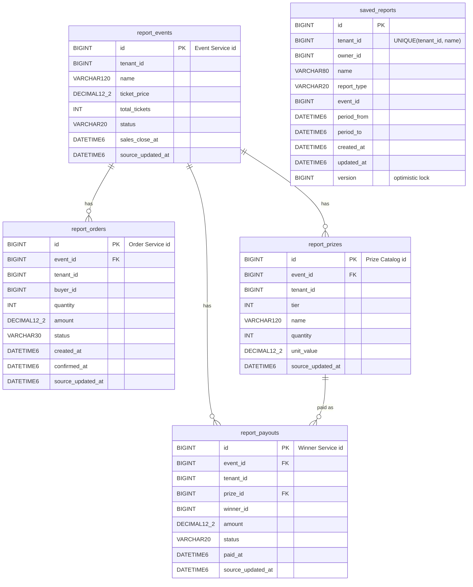

# Reporting Service: API and Database Contract

Subtask 01 · Version 1.0 · Base path `/api/reports` (gateway `http://localhost:8080`, direct `http://localhost:8092`) · JSON, UTF-8, ISO-8601 UTC timestamps, money in BTN with 2 decimals.

## 1. Identifiers

| Identifier | Owner service | Used for | Constraint |
|---|---|---|---|
| `tenantId` | Organizer/Tenant Service | report scope; **must equal** the organizer's JWT `tenantId` | positive int64 |
| `eventId` | Event Service | event filter, summaries, saved reports | positive int64; must exist in the read model and be visible (404) |
| `orderId` | Order Service | ingest only | positive int64 |
| `prizeId` | Prize Catalog Service | ingest; payouts reference it | positive int64; must belong to the payout's event (422) |
| `payoutId` | Winner Service | ingest only | positive int64 |
| `buyerId`, `winnerId` | Auth Service (`sub`) | student's own purchases | positive int64 |
| saved report `id` | **this service** | saved report CRUD | generated int64 |

### Report filters

| Parameter | Type | Rule |
|---|---|---|
| `tenantId` | int64 | optional. For organizers it is forced to the JWT tenant, and a different value is 403. For admins it is optional (omit for platform-wide). |
| `eventId` | int64 | optional; must be a visible event, else 404 |
| `from`, `to` | ISO-8601 instant | optional; filter orders by `createdAt` (`from` inclusive, `to` exclusive); `from < to`; ≤ 366 days |
| `status` | `DRAFT, OPEN, CLOSED, DRAWN, CANCELLED` | events list only |
| `page`, `size` | int | `page` ≥ 0; `size` 1–100 (default 20) |

## 2. Report responses (aggregates)

| Report | Fields |
|---|---|
| **Sales** | `currency, confirmedOrders, ticketsSold, revenue, averageOrderValue, pendingOrders, pendingAmount, failedOrders, conversionRatePercent, daily[{date, orders, tickets, revenue}]` |
| **Tickets** | `capacity, sold, reserved, available, sellThroughPercent` |
| **Prizes** | `currency, prizeTiers, prizeUnits, totalPrizeValue, tiers[{prizeId, tier, name, quantity, unitValue, totalValue}]` |
| **Payouts** | `currency, winners, totalAmount, paidCount, paidAmount, pendingCount, outstandingAmount, cancelledCount, paidPercent` |
| **Event summary** | `eventId, tenantId, name, status, ticketPrice, sales, tickets, prizes, payouts, netAfterPrizes` |
| **Overview** | `tenantId, events, eventsByStatus, sales, tickets, prizes, payouts, netAfterPrizes` |
| **Events list row** | `eventId, name, status, ticketPrice, capacity, ticketsSold, revenue, sellThroughPercent` |
| **My purchases** | `buyerId, currency, confirmedTickets, totalSpent, events[{eventId, eventName, confirmedTickets, spent, pendingOrders, failedOrders}]` |

### Definitions

* **Revenue** = sum of `CONFIRMED` order amounts.
* **Pending** = `AWAITING_PAYMENT` + `AWAITING_VERIFICATION`.
* **Conversion** = confirmed ÷ (confirmed + failed).
* **Reserved** = tickets in pending orders.
* **Available** = capacity − sold − reserved (never below 0).
* **Payout total and outstanding** exclude `CANCELLED`.
* **Net after prizes** = revenue − total prize value.
* **Daily** is grouped by the UTC date of `createdAt`.
* All percentages and money are rounded half-up to 2 decimals.

## 3. Ingest contract (what other services send)

**REST:** `PUT /api/reports/ingest/{events|orders|prizes|payouts}/{id}` with a SERVICE or ADMIN token. The body `id` is optional, and must equal the path id if given.

**RabbitMQ:** topic exchange `yongdrel.reporting.feed`. The body `id` is required.

| Routing key | Queue | Body (required fields **bold**) |
|---|---|---|
| `event.upserted` | `reporting.events` | **id, tenantId, name** (≤ 120), **ticketPrice** (0–100 000 000, 2 dp), **totalTickets** (1–1 000 000), **status**, salesCloseAt, **sourceUpdatedAt** |
| `order.upserted` | `reporting.orders` | **id, eventId, tenantId, buyerId, quantity** (1–100), **amount, status** (`AWAITING_PAYMENT, AWAITING_VERIFICATION, CONFIRMED, FAILED`), **createdAt**, confirmedAt (**required iff CONFIRMED**, not before createdAt), **sourceUpdatedAt** |
| `prize.upserted` | `reporting.prizes` | **id, eventId, tenantId, tier** (1–50), **name, quantity** (1–1000), **unitValue, sourceUpdatedAt** |
| `payout.upserted` | `reporting.payouts` | **id, eventId, tenantId, prizeId, winnerId, amount, status** (`PENDING, PAID, CANCELLED`), paidAt (**required iff PAID**), **sourceUpdatedAt** |

Invalid messages and unresolvable references go to `yongdrel.reporting.dlx` → `reporting.feed.dlq`. Stale messages are acknowledged and ignored.

**REST outcomes:**

* **201** `CREATED`; **200** `UPDATED` or `UNCHANGED`.
* **409** for an older version, the same version with different content, or a changed immutable field (event `tenantId`; order `eventId/tenantId/buyerId`; prize `eventId/tenantId`; payout `eventId/tenantId/prizeId/winnerId`).
* **422** for an unknown event, a tenant mismatch, or an unknown prize or a prize of another event.

## 4. Saved reports

| Field | Rule |
|---|---|
| `name` | 1–80 characters, unique per tenant (case-insensitive) → 409 |
| `reportType` | `OVERVIEW, EVENT_SUMMARY, SALES, TICKETS, PRIZES, PAYOUTS`; `EVENT_SUMMARY` requires `eventId` |
| `eventId` | optional; must be an event of the organizer's tenant (404) |
| `from`, `to` | optional; same rules as the report filters |

* **Read and run:** any organizer of the tenant.
* **Update and delete:** only the creator (403 for colleagues).
* **Other tenants:** 404.

## 5. Endpoints and status codes

| Endpoint | Success | Errors |
|---|---|---|
| `GET /overview`, `/sales`, `/tickets`, `/prizes`, `/payouts` | 200 | 400, 401, 403, 404 (eventId) |
| `GET /events` | 200 page | 400, 401, 403 |
| `GET /events/{eventId}/summary` | 200 | 400, 401, 403, 404 |
| `GET /me/purchases` | 200 | 401, 403 |
| `POST /saved` | 201 + `Location` | 400, 401, 403, 404, 409 |
| `GET /saved`, `GET /saved/{id}`, `GET /saved/{id}/run` | 200 | 400, 401, 403, 404 |
| `PUT /saved/{id}` | 200 | 400, 401, 403, 404, 409 |
| `DELETE /saved/{id}` | 204 | 401, 403, 404 |
| `PUT /ingest/{kind}/{id}` | 201 / 200 | 400, 401, 403, 409, 422 |
| `GET /actuator/health` | 200 | 503 when DB or broker is down |

**Error body:** `{timestamp, status, error, message, path, fieldErrors?: [{field, message}]}`.

## 6. Database schema (`yongdrel_reporting`, Flyway V1)

**Indexes:**

* `report_events(tenant_id, status)`
* `report_orders(tenant_id, event_id, created_at)`, `(event_id, status)`, `(buyer_id)`
* `report_prizes(tenant_id, event_id, tier)`
* `report_payouts(tenant_id, event_id, status)`

The foreign keys exist only **inside** this schema, between projections. No foreign key points at another service's database.
